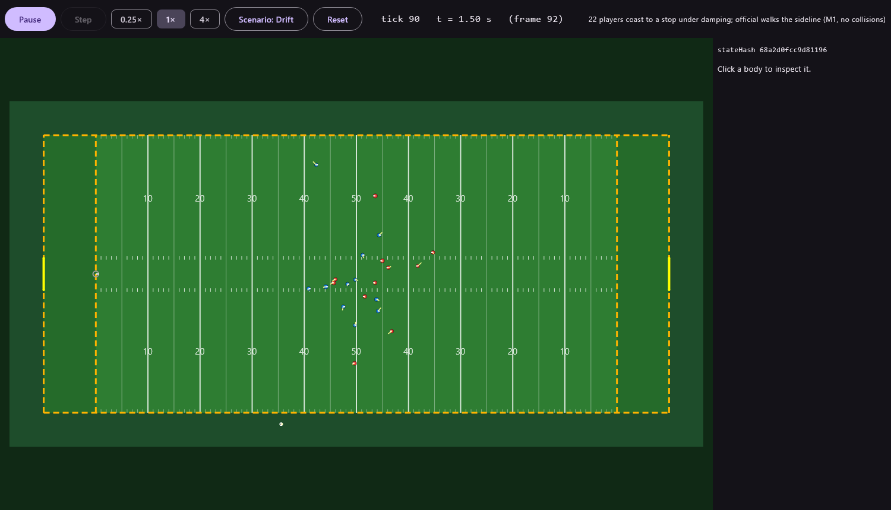

# gridiron-physics

[](https://github.com/itstrue54/gridiron-physics/actions/workflows/ci.yml)

A deterministic, top-down 2D rigid-body engine in pure Kotlin, tuned for 22 players and one ball on a
regulation football field. The engine owns motion, contact and ball flight; the game owns ratings, AI,
play logic and rules. Same seed + same inputs = the same result on Android, Windows, macOS and Linux.

- Physics spec: [`docs/PHYSICS_SPEC.md`](docs/PHYSICS_SPEC.md)
- Design: [`docs/superpowers/specs/2026-11-07-gridiron-physics-design.md`](docs/superpowers/specs/2026-11-07-gridiron-physics-design.md)



## Modules

| Module | Contents | Ships in games? |
|---|---|---|
| `physics-core` | The engine (Kotlin stdlib + `StrictMath` only, Java 11 bytecode) | Yes |
| `physics-scenarios` | Scenario scripts, the 1,000-play determinism harness and its golden data, shared by tests and the viewer | No |
| `physics-debug` | Compose Desktop debug viewer | No |
| `physics-bench` | kotlinx-benchmark (JMH) benchmarks, headless ticks/s and the performance gates | No |
| `physics-android-test` | Android instrumented determinism tests (built only where an Android SDK is installed) | No |

## Building

```bash
./gradlew build                  # everything
./gradlew :physics-core:test     # engine tests
./gradlew :physics-debug:run     # debug viewer
./gradlew :physics-debug:run -Preplay=path/to/play.gpr          # open a replay in the viewer
./gradlew :physics-android-test:connectedDebugAndroidTest        # determinism on a device or emulator
./gradlew :physics-scenarios:generateGolden                      # regenerate golden digests (only when behaviour should change)
./gradlew :physics-bench:benchmark                               # JMH: us per step, 25-player scrimmage and whole plays
./gradlew :physics-bench:ticksPerSecond                          # headless ticks per second
```

## Performance

Spec budgets: 0 heap allocations per `step()`, >= 20,000 ticks/s headless on a desktop, <= 0.5 ms per step on a
mid-range phone (25 dynamic bodies). `./gradlew build` gates the first two: `StepAllocationTest` (physics-scenarios)
counts the bytes allocated inside `step()` across the 1,000 random plays and every scenario, once normally and once
with escape analysis off (`allocationTestNoEscapeAnalysis`, so a temporary that HotSpot optimises away but Android's
runtime would allocate still fails it); `PerformanceGateTest` (physics-bench) times the 25-player scrimmage. The phone
budget needs a real phone: CI's Android emulator job logs the scrimmage's ms per step (`GridironBench`) as a report.
The broad phase is still brute force (25 bodies is about 300 pairs); a grid was not needed.

## Snapshots and replays

`World.snapshot()` captures the whole simulation state (bodies, joints, contacts with warm-start impulses, the ball,
events, the rng) as bytes; `restore()` puts any world with the same `WorldConfig` and `FieldConfig` back in that state,
and it steps on identically. A `ReplayRecorder` attached to a world records every command and every tick's
`stateHash()` without allocating; `Replay.encode()` gives the `.gpr` bytes (little-endian, versioned) and
`ReplayPlayer` replays them, reporting the first tick whose hash does not match. File I/O is the caller's job.

## Using it from a game

**From source (approach A, the default).** Clone this repo next to your game, then in the game's `settings.gradle.kts`:

```kotlin
includeBuild("../gridiron-physics") {
    dependencySubstitution {
        substitute(module("io.github.itstrue54:gridiron-physics-core")).using(project(":physics-core"))
    }
}
```

and in the module that uses it:

```kotlin
dependencies {
    implementation("io.github.itstrue54:gridiron-physics-core:0.8.0")
}
```

(`implementation("io.github.itstrue54:physics-core:0.8.0")` also still works with a plain `includeBuild`.)

**Published (approach B, optional).** `./gradlew :physics-core:publishToMavenLocal` puts the artifact in `mavenLocal()`;
`./gradlew :physics-core:publish` with `GITHUB_ACTOR` and `GITHUB_TOKEN` set pushes it to this repo's GitHub Packages
(nothing publishes automatically). A game then drops the `includeBuild` block and adds the repository
(`maven("https://maven.pkg.github.com/itstrue54/gridiron-physics")` with credentials, or `mavenLocal()`); the
dependency line stays the same.
